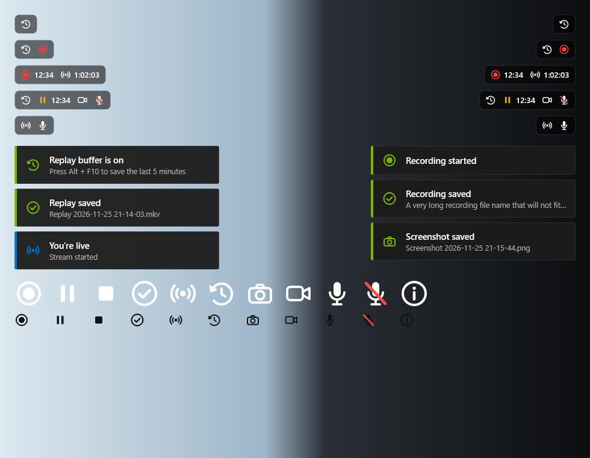

# obs-indicator

[](https://github.com/l5z12/obs-indicator/actions/workflows/build.yml)
[](https://github.com/l5z12/obs-indicator/releases/latest)
[](LICENSE)

A Windows-only OBS Studio plugin that shows a ShadowPlay-style on-screen overlay while you play:

- **Status indicator.** Small icons in a screen corner while the replay buffer, recording, stream or
  virtual camera is active. Optional elapsed-time readout and microphone (muted/live) icon.
- **Notifications.** Toasts that slide in for "Replay buffer is on" (with your save hotkey and buffer
  length), "Replay saved", "Recording started/paused/saved", "You're live", "Screenshot saved",
  and so on. File names are shown for saved replays, recordings and screenshots.


The overlay is **hidden from screen capture** by default, so it never ends up in your recordings or
stream, even with Display Capture. It is click-through, never takes focus, and **does not inject into
games**, so anti-cheat has nothing to object to.

## Install

You need:

- Windows 10 version 2004 or newer (needed for capture exclusion), or Windows 11
- OBS Studio 33 or newer, 64-bit x64 (the ARM64 build of OBS isn't supported)

1. Download `obs-indicator-<version>-windows-x64.zip` from the
   [latest release](https://github.com/l5z12/obs-indicator/releases/latest).
2. Close OBS.
3. Extract the zip into `C:\ProgramData\obs-studio\plugins\`. You should end up with:

   ```
   C:\ProgramData\obs-studio\plugins\obs-indicator\
       obs-indicator.dll
       data\
   ```

4. Start OBS. The plugin appears in **Tools → Plugin Manager**, and its settings are in
   **Tools → Overlay Indicator**.

To uninstall, delete that `obs-indicator` folder. Your settings stay in
`%APPDATA%\obs-studio\plugin_config\obs-indicator\` until you delete that folder too.

## Usage

- **Tools → Overlay Indicator** opens the settings. **Preview** shows a sample indicator and
  notification with the values you're editing.
- **Settings → Hotkeys → "Toggle overlay indicator"** sets a hotkey that turns the overlay on and off.


| Setting | What it does |
| --- | --- |
| Position | Any corner, set separately for the indicator and the notifications. When both use the same corner, notifications stack next to the indicator. |
| Show icons for | The outputs that get an icon. The indicator only appears while at least one of them is active. |
| Microphone | Shows a mic icon *when muted* or *always*. The source is the global Mic/Aux device or any audio source you pick. |
| Display | Primary display, a specific display, or **the display with the active window**, which follows your game. |
| Size / Opacity / Margin | Size multiplies the display's own DPI scaling. |
| Accent color | Used for the notification bar and icons. |
| Hide from screen capture | Uses `WDA_EXCLUDEFROMCAPTURE`. Turn it off if you *want* the overlay in a Display Capture. |

## Limitations

- **True exclusive fullscreen.** Like any overlay that doesn't inject into the game, this one is
  visible over windowed, borderless and "fullscreen optimized" games (the Windows default). It is not
  visible if a game runs in legacy exclusive fullscreen with fullscreen optimizations disabled. Use
  borderless mode in that case.
- The mic icon follows the source's **mute** state. Push-to-talk isn't reflected.
- Elapsed times count from when OBS reported the start, not from the first encoded frame.

## Building from source

You need Visual Studio 2022 or newer with *Desktop development with C++* (it includes CMake and Ninja),
plus Git.

```powershell
.\scripts\build.ps1            # build into .\build, against your installed OBS
.\scripts\build.ps1 -Install   # build, then install for OBS (close OBS first)
```

The build doesn't need OBS's source code or Qt. `scripts/fetch-obs-headers.ps1` does a sparse checkout
of just the `libobs/` and `frontend/api/` headers for your installed OBS version. It runs on every build
and re-fetches the headers after an OBS update. Import libraries are generated from your installed
`obs.dll` and `obs-frontend-api.dll`.

`-Install` copies the plugin to `C:\ProgramData\obs-studio\plugins\obs-indicator\` in the
[OBS 33 layout](https://obsproject.com/kb/legacy-plugin-locations). It also removes a copy left in the
older `bin\64bit\` layout, which OBS flags as *Legacy*.

See [CONTRIBUTING.md](CONTRIBUTING.md) for building without OBS installed, the developer tools, and
how releases are made.

## How it works

```
OBS UI thread                         overlay thread (own message loop)
─────────────                         ─────────────────────────────────
frontend events ─┐                    ┌─ indicator window ┐ WS_EX_LAYERED | TRANSPARENT
mute signals ────┼─ Status / Toast ──►│                   │ TOPMOST | NOACTIVATE | TOOLWINDOW
settings dialog ─┘   (mutex + post)   └─ toast window ────┘ Direct2D (software) → UpdateLayeredWindow
```

- `src/plugin-main.cpp` is the OBS glue: frontend events, mic signals, settings persistence, the Tools
  menu entry and the hotkey.
- `src/overlay.cpp` runs the windows, animation, monitor selection and z-order upkeep on a private
  thread, and sleeps when nothing is animating.
- `src/renderer.cpp` draws all artwork with Direct2D/DirectWrite. The icons are vector paths on a
  24×24 grid, with no image assets.
- `src/settings-dialog.cpp` and `src/obs-indicator.rc` hold the native settings dialog. It uses
  Common Controls v6 through the DLL's embedded manifest.
- `tools/` has two standalone programs that exercise the overlay without OBS: `overlay-demo` plays a
  scripted session or opens the settings dialog, and `overlay-preview` renders every state to a PNG.



## Contributing

Issues and pull requests are welcome. Please read [CONTRIBUTING.md](CONTRIBUTING.md) first.

## License

GPL-2.0-or-later, the same as OBS Studio (see [LICENSE](LICENSE)).
