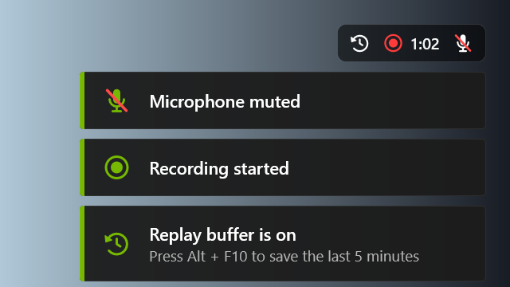
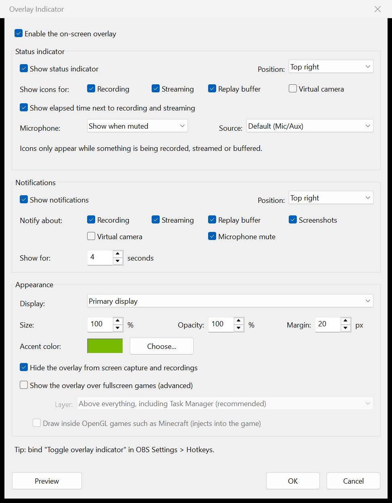

# obs-indicator

A ShadowPlay-style overlay for OBS Studio on Windows. A small indicator shows while you're recording, streaming or
running the replay buffer, and a notification pops up when something happens, like "Replay saved".

The overlay never appears in your recordings or stream, never takes focus, and doesn't hook into games, so
anti-cheat has nothing to complain about.

## Install

You need Windows 10 (version 2004 or newer) or Windows 11, and 64-bit OBS Studio 33 or newer.

1. Download `obs-indicator-<version>-windows-x64.zip` from the
   [latest release](https://github.com/l5z12/obs-indicator/releases/latest).
2. Close OBS and extract the zip into `C:\ProgramData\obs-studio\plugins\`.
3. Start OBS.

To uninstall, delete `C:\ProgramData\obs-studio\plugins\obs-indicator`.

## Use

Open **Tools → Overlay Indicator** to choose what shows, where, and how big. **Preview** shows the result.
To turn the overlay on and off while you play, set a key for **Toggle overlay indicator** in
**Settings → Hotkeys**.

The plugin uses OBS's language: English, 简体中文, 繁體中文, 日本語, 한국어, Deutsch, Français, Español,
Português (Brasil) or Русский.

## Troubleshooting

- **The overlay doesn't show over a game.** The game is probably using an old exclusive fullscreen mode, which no
  overlay can draw over without hooking into the game. Switch the game to borderless or windowed fullscreen.
- **You want the overlay in your recording.** Untick *Hide the overlay from screen capture* in the settings.
- **The mic icon ignores push-to-talk.** It follows the mic's mute state only.
- **Something else.** [Open an issue](https://github.com/l5z12/obs-indicator/issues/new/choose) and attach your
  OBS log (**Help → Log Files → Upload Current Log File**).

## License

GPL-3.0-or-later. Want to help? See [CONTRIBUTING.md](CONTRIBUTING.md).
